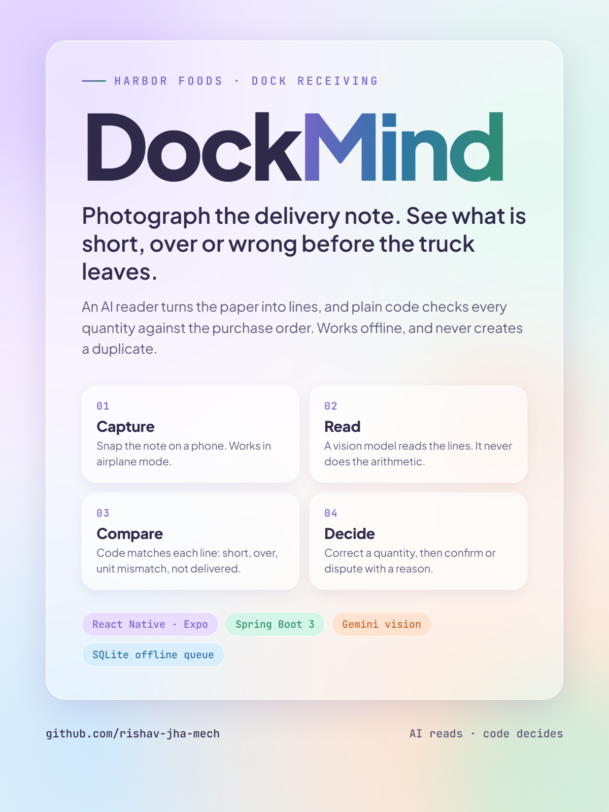
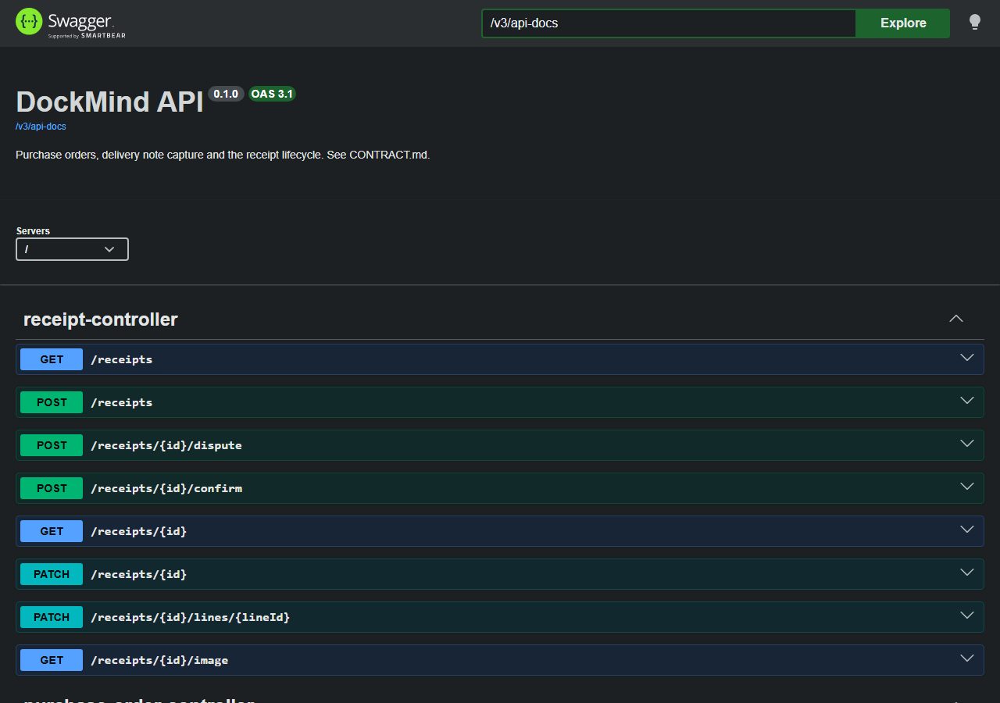
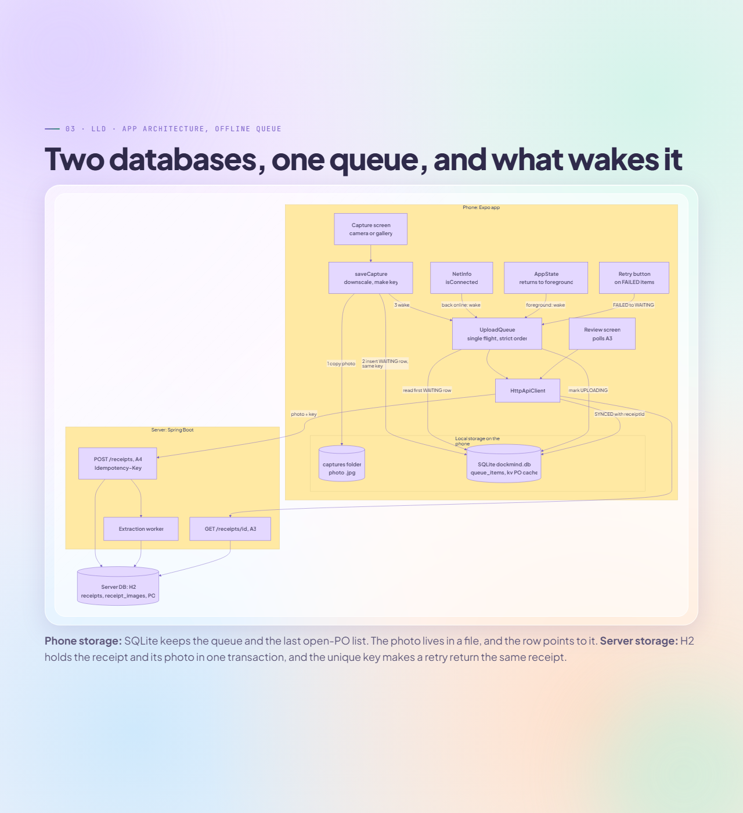
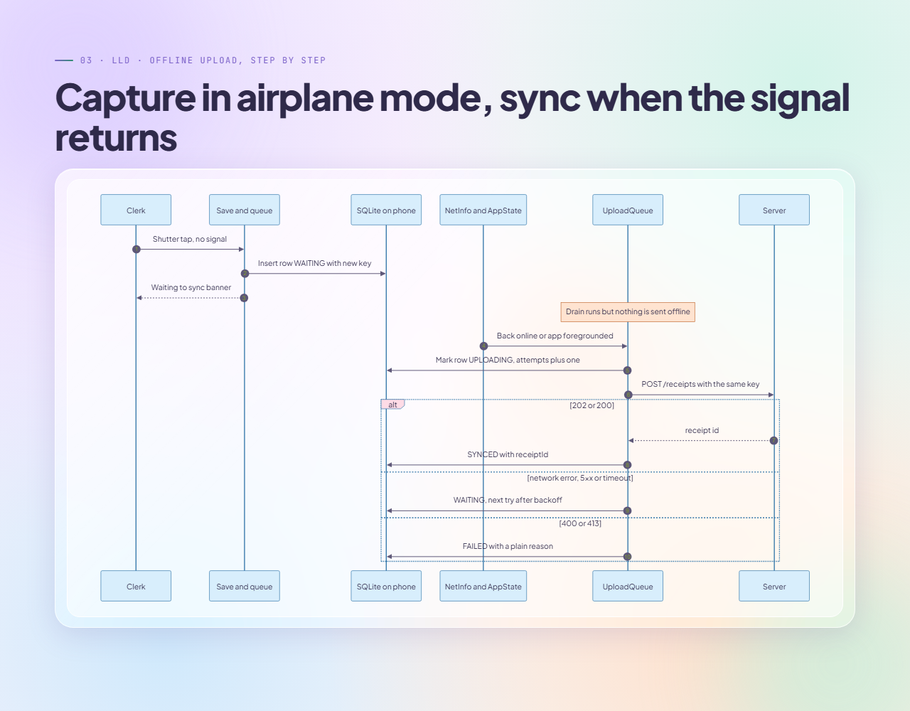
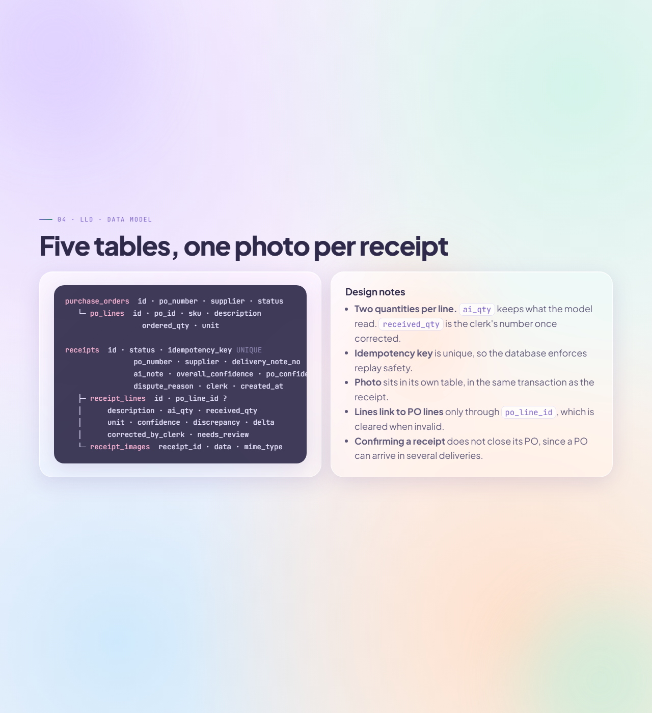
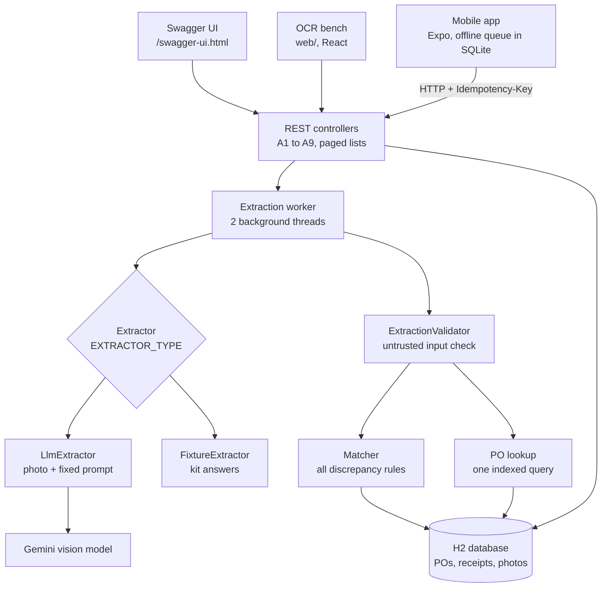

# DockMind



**AI Dock Receiver.** Photograph a delivery note at the dock. An AI reader turns it into lines, plain code checks every quantity against the purchase order, and the clerk sees what is short, over or wrong before the truck leaves. It keeps working with no signal, and it never creates a duplicate receipt.

Built by GitHub: [rishav-jha-mech](https://github.com/rishav-jha-mech)

---

## What it does

1. **Capture.** The clerk photographs the note with the app. The photo, and an idempotency key, are saved to the phone's queue before any upload.
2. **Read.** A vision model reads the supplier, the PO number as written, and the lines. It is never shown the purchase orders and never does arithmetic.
3. **Check.** Code validates the answer, looks up the PO by its number, checks the supplier, and classifies each line: `MATCH`, `SHORT`, `OVER`, `UNIT_MISMATCH`, `UNKNOWN_ITEM` or `NOT_DELIVERED`.
4. **Decide.** The clerk corrects a quantity if needed, ticks any flagged lines, then confirms or disputes with a reason.

Any read that fails, or any PO that cannot be resolved, lands in `NEEDS_MANUAL` with the photo kept. Nothing is dropped and nothing becomes a 500.

## Screenshots

**Live API documentation (Swagger UI)**



**App architecture: two databases, one offline queue**



**Offline upload, step by step**



**Backend pieces**



The full walkthrough is in [`assets/dockmind-presentation.html`](assets/dockmind-presentation.html). Open it in a browser and use the arrow keys.

## Architecture



The model reads, the validator checks, the lookup finds the order, and the matcher decides. The workflow is a fixed pipeline with one AI step. A person takes over only when a PO cannot be resolved.

More detail is in [`docs/ARCHITECTURE.md`](docs/ARCHITECTURE.md), which covers the receipt lifecycle, the measured results at 100,000 purchase orders, and the scaling plan. The API contract is in [`CONTRACT.md`](CONTRACT.md).

## Repository layout

| Folder | What it holds |
|---|---|
| `backend/` | Spring Boot 3 API, extraction, matching, H2 database, Swagger |
| `mobile/` | Expo (React Native) app: capture, offline queue, review, decisions |
| `web/` | React OCR bench, used to preview the backend |
| `kit/` | Starter kit: seed data, delivery notes, fixtures |
| `docs/` | Architecture notes and plans |
| `assets/` | Presentation deck and flyer |

## Run it locally

### Backend

Requires Java 17 or later. The Maven wrapper is included.

```bash
cd backend
./mvnw spring-boot:run          # Windows: mvnw.cmd spring-boot:run
```

The server starts on port `8080`. Open `http://localhost:8080/swagger-ui.html` for the API docs.

By default it uses the fixture extractor, so no key is needed. To use the real vision model, create `backend/.env`:

```properties
EXTRACTOR_TYPE=llm
LLM_API_KEY=your-gemini-key
LLM_MODEL=gemini-3.1-flash-lite
```

Never commit `.env`. It is gitignored.

### Mobile app

Requires Node.js and Expo. On an Android emulator, `10.0.2.2` reaches the host machine.

```bash
cd mobile
npm install
EXPO_PUBLIC_API_URL=http://10.0.2.2:8080 npx expo start
```

Open the project in Expo Go on the emulator or a phone. On a physical phone, use the host's LAN address in place of `10.0.2.2`.

### OCR bench (optional)

```bash
cd web
npm install
npm run dev
```

## Configuration

| Variable | Default | Purpose |
|---|---|---|
| `EXTRACTOR_TYPE` | `fixture` | `fixture` returns the kit's canned answers. `llm` reads the photo with the model. |
| `LLM_API_KEY` | none | Gemini API key, needed for `llm` |
| `LLM_MODEL` | `gemini-3.1-flash-lite` | Any vision-capable Gemini model |
| `PORT` | `8080` | Port to listen on, set by the host |
| `DOCKMIND_DATA` | `./data` | Folder for the H2 database |
| `EXPO_PUBLIC_API_URL` | set in `mobile/src/config.ts` | Backend base URL for the app |

## Tests

```bash
cd backend && ./mvnw test
cd mobile && npm test && npm run typecheck
```

## Design decisions

- **Discrepancy logic lives in code, not in the model.** A discrepancy can start a dispute with a supplier, so it has to be repeatable and testable.
- **Every model answer is validated.** Markdown is stripped, numbers are coerced, confidence is clamped, and the PO and supplier must agree before anything is saved.
- **Capture is idempotent end to end.** The phone creates the key once and reuses it on every retry. The server enforces a unique constraint on it.
- **Offline capture goes through a local queue.** The queue drains in order, with backoff, and it recovers after an app kill.

The full set of answers, including what was cut, is in [`DECISIONS.md`](DECISIONS.md). The AI-assisted build process is in [`AI-LOG.md`](AI-LOG.md).

## Author

[github.com/rishav-jha-mech](https://github.com/rishav-jha-mech)
