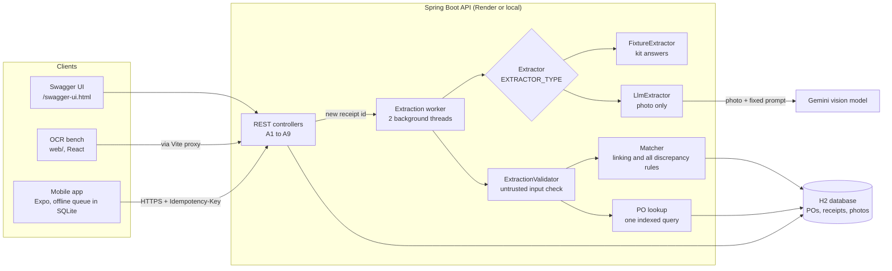
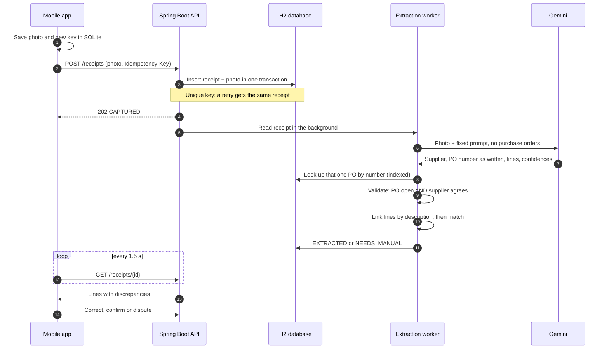
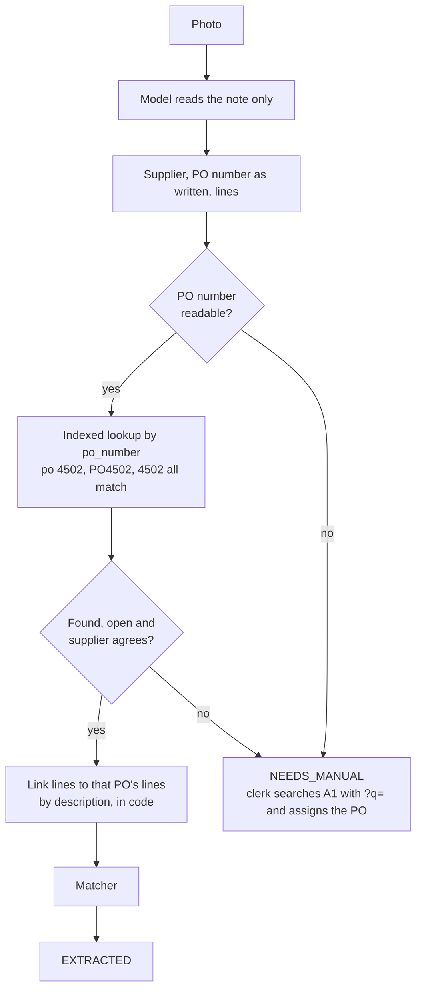
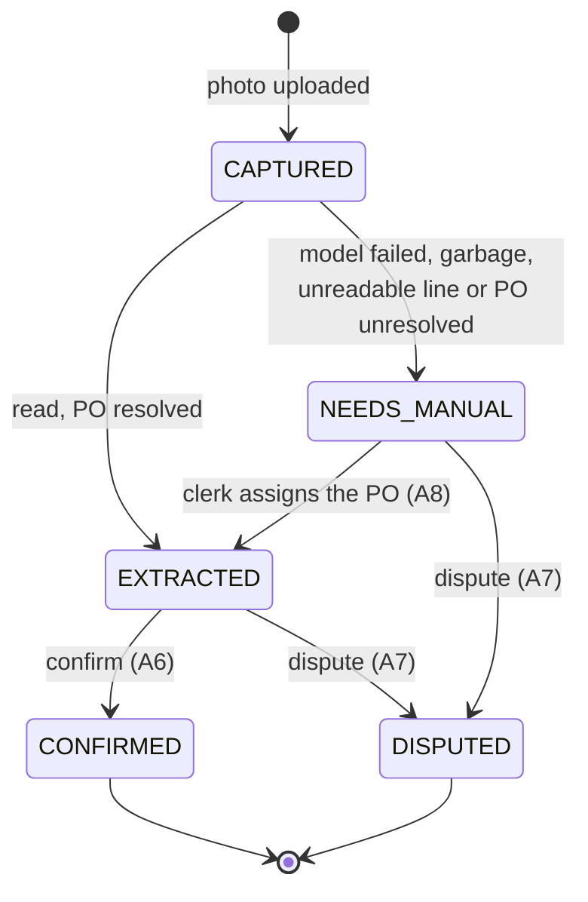

# DockMind architecture

How a delivery note becomes a checked receipt, and how it holds up at 100,000 purchase orders.

## 1. The pieces

The model only reads. The validator decides whether the answer can be trusted, the lookup finds the PO, and the matcher decides what is wrong with the delivery. Nothing the model says reaches the database without passing all three.

## 2. One note, from shutter to database row

**Are we extracting the order number and then checking it?** Yes. The model returns the PO number exactly as written, or null if any character is unclear. Code then finds that one PO and checks that the supplier agrees. The model is never shown the list of POs.

## 3. Receipt lifecycle

A receipt stuck in `CAPTURED` after a crash is read again when the server starts.

## 4. At 100,000 orders: before and after

The first version sent the model every open PO with each photo. That added about 70 tokens per PO, and the model accepts about 1.05 million input tokens.

Measured on a local server with 100,004 open POs and 200,000 PO lines, running with a 307 MB heap:

| Part | Before | Now | Measured at 100,004 POs |
|---|---|---|---|
| Prompt to the model | Every open PO and its lines. Fails at about 15,000 POs, about 7 million tokens at 100,000 | Fixed 1,771 characters | All nine kit notes read in 2 to 7 seconds |
| Finding the PO for a note | All open POs loaded and scanned for every photo | One query on the unique `po_number` index | Included in the read times above |
| A1 `GET /purchase-orders` | Every PO with lines | Pages of 50, `?q=` search, total in `X-Total-Count` | First page 0.16 s, page 2,000 0.19 s, search 0.05 to 0.07 s |
| A2 `GET /receipts` | Every receipt | Pages of 50, newest first, indexed | Under 0.01 s |
| Idempotent capture | Unique constraint on the key | Unchanged | |
| Matching and validation | One receipt, one PO | Unchanged | |

**Still not built for scale:**

- **Database:** embedded H2, one server, photos stored as blobs. Next step is Postgres plus object storage, so several servers can run and data survives restarts. On Render's free tier, today's data is lost on every restart.
- **Background reads:** an in-memory pool of 2 threads, about 20 to 30 notes a minute. Crashed reads are recovered, but work is not shared across servers. Next step is a durable job queue.
- **Supplier search:** `?q=` uses a contains match, which scans the table. It took 0.05 seconds at 100,000 POs, but full-text search would be the step after that.

## 5. Results from the real model

All nine kit notes through `gemini-3.1-flash-lite`, with 100,004 open POs in the database:

| Note | Outcome | Right? |
|---|---|---|
| 1 clean | All match | Yes |
| 2 short | Short, not ordered, not delivered | Yes |
| 3 messy | `NEEDS_MANUAL`. The model said the PO number was smudged and could not be read | Yes. Before the change it guessed PO-4503 and nothing was flagged |
| 4 over | Apples +20, others match despite `KGS` and `CASES` | Yes |
| 5 eggs | PO-4513, match | Yes |
| 6 wrong supplier | `NEEDS_MANUAL`, caught by the supplier check | Yes |
| 7 no PO | `NEEDS_MANUAL` | Yes |
| 8 crossed out | Read 78, not the struck-out 80, and said so in the note | Yes, but the confidence was 0.9, so the line was not flagged |
| 9 cafe receipt | `NEEDS_MANUAL`, called it a cafe receipt | Yes |

The model still reports high confidence on most lines, including handwriting. The supplier check and the PO lookup do the real safety work, and confidence is a weak signal with this model.
